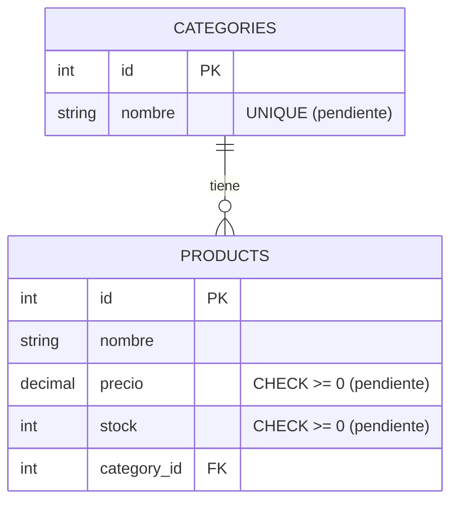

# ERM

Modelo de datos de Inventario Inteligente: una categoría tiene muchos productos. Refleja lo que necesita la UI (canvas https://claude.ai/artifact/1A69kPKbtKFKHH1BHSC2Zr). El mismo esquema corre en local y en Neon, aplicado con Alembic.

Los constraints marcados **pendiente** todavía no existen en la base: requieren una migración Alembic.

## Tablas

### categories

| Campo  | Tipo        | Restricciones                     |
| ------ | ----------- | --------------------------------- |
| id     | Integer     | PK, autoincrement                 |
| nombre | String(255) | NOT NULL, UNIQUE **(pendiente)**  |

### products

| Campo       | Tipo          | Restricciones                     |
| ----------- | ------------- | --------------------------------- |
| id          | Integer       | PK, autoincrement                 |
| nombre      | String(255)   | NOT NULL                          |
| precio      | DECIMAL(10,4) | NOT NULL, CHECK `>= 0` **(pendiente)** |
| stock       | Integer       | NOT NULL, CHECK `>= 0` **(pendiente)** |
| category_id | Integer       | FK → categories.id, NOT NULL      |

Motivo de los pendientes: la UI identifica categorías por nombre en selects y filtros (duplicados la rompen); el form de producto restringe precio y stock a `min="0"`.

## Relación

- 1 categoría → N productos, por `products.category_id` (sin `relationship()` en SQLAlchemy).
- Borrar una categoría con productos falla por la FK (`NO ACTION`). La UI no ofrece "eliminar categoría".

## Trazabilidad UI → datos

| Pantalla         | Lee                                          | Escribe                          |
| ---------------- | -------------------------------------------- | -------------------------------- |
| Inicio           | products, categories                         | —                                |
| Productos        | products + `categories.nombre`               | DELETE product (editar: futuro)  |
| Categorías       | categories + agregados por categoría         | INSERT category (editar: futuro) |
| Nuevo producto   | categories (select)                          | INSERT product                   |
| Panel de chat IA | lo que consulte el agente SQL (solo lectura) | —                                |

## Valores derivados

Se calculan en consulta o en el front; no se guardan.

- Productos por categoría: `COUNT(products.id)`.
- Unidades por categoría y total: `SUM(products.stock)`.
- Valor de inventario, total y por categoría: `SUM(precio * stock)`.
- Stock bajo: `stock <= 10` (umbral fijo del front).

## Fuera del modelo

- Historial del chat: el `thread_id` vive en la memoria del agente, no en la base.
- Umbral de stock por producto y timestamps (`created_at` / `updated_at`): se agregan cuando una pantalla los use.

## Pendientes

- Migración Alembic con `UNIQUE (categories.nombre)`, `CHECK (precio >= 0)` y `CHECK (stock >= 0)`.
- `Product.precio` está tipado `Mapped[float]` sobre `DECIMAL`; debería ser `Mapped[Decimal]`.
