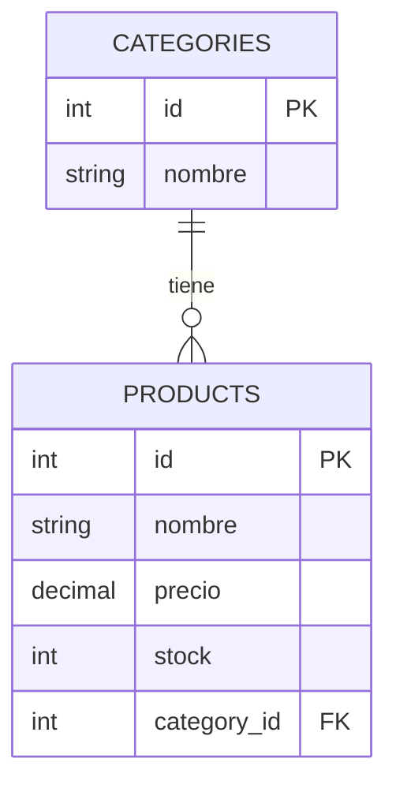

# ERM

Modelo de ejemplo para practicar FastAPI: una categoría tiene muchos productos.

## Tablas

### categories
| Campo  | Tipo         | Restricciones     |
|--------|--------------|-------------------|
| id     | Integer      | PK, autoincrement |
| nombre | String(255)  | NOT NULL          |

### products
| Campo       | Tipo          | Restricciones                |
|-------------|---------------|------------------------------|
| id          | Integer       | PK, autoincrement            |
| nombre      | String(255)   | NOT NULL                     |
| precio      | DECIMAL(10,4) | NOT NULL                     |
| stock       | Integer       | NOT NULL                     |
| category_id | Integer       | FK → categories.id, NOT NULL |

## Relación
- 1 categoría → N productos (por `products.category_id`; todavía sin `relationship()` en SQLAlchemy).
